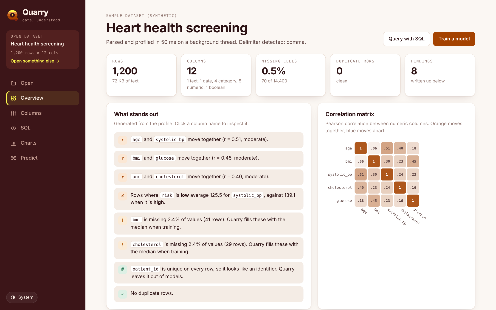
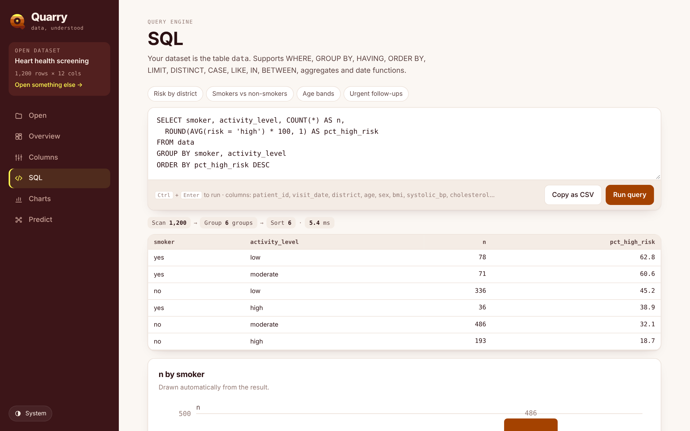
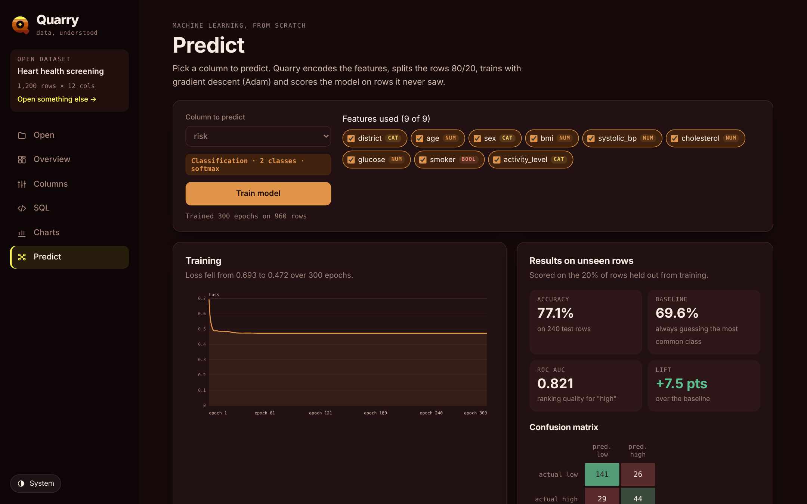

<h1 align="center">Quarry</h1>

<b>Every spreadsheet is a quarry.</b> 
Data profiling, a SQL engine, charts and machine learning, all running in your browser.

<a href="https://sjamillah.github.io/Quarry/"><b>Live demo →</b></a>

## What it does

Quarry opens on a landing page that explains the idea: every spreadsheet is a quarry, worked one layer at a time. From there, open any CSV (or one of three built-in sample datasets) and Quarry will:

- **Profile every column.** It infers types (integer, number, date, boolean, category, text) and reports missing values, quantiles, skew, IQR outliers, histograms and top values.
- **Write up what stands out.** Findings are generated automatically: strong correlations, group differences, missing data, skew, identifier columns and duplicate rows, plus a correlation matrix.
- **Answer questions in SQL.** It runs on a query engine written from scratch, covering `WHERE`, `GROUP BY` (by name, alias or position), `HAVING`, `ORDER BY`, `LIMIT`, `DISTINCT`, `CASE`, `LIKE`, `IN`, `BETWEEN`, `IS NULL`, aggregates (`COUNT`, `SUM`, `AVG`, `MIN`, `MAX`, `MEDIAN`, `COUNT(DISTINCT …)`) and scalar and date functions. Each query shows its execution plan with row counts and timing. Errors point to the exact character and suggest the column you probably meant.
- **Draw the right chart.** It picks bars for categories, a line over time with automatic day, week or month buckets, a scatter with a least-squares trend line, or a histogram.
- **Train a model live.** Softmax classification and linear regression are written without any ML library. Features are standardised and one-hot encoded with median imputation, the rows are split 80/20, and training uses the Adam optimiser with L2 regularisation and an animated loss curve. Results include accuracy, ROC AUC, macro F1, a confusion matrix, R², MAE and RMSE, always compared against a naive baseline. A what-if panel gives instant predictions.

## Engineering notes

| Area | Approach |
|---|---|
| Parsing | A hand-written RFC 4180 state machine handles quoted fields, escaped quotes, embedded newlines, BOM and CRLF. The delimiter (comma, semicolon, tab or pipe) is detected by consistency scoring. |
| Concurrency | Parsing and profiling run in a **Web Worker** built at runtime from the same source as the main-thread fallback, so the UI never blocks. |
| SQL | Lexer, then a recursive-descent parser that builds an AST, then an executor with scan, filter, group, having, distinct, sort and limit stages. Three-valued `NULL` logic, date-literal coercion and Levenshtein "did you mean" suggestions are included. |
| ML | Full-batch gradient descent with Adam (β₁ 0.9, β₂ 0.999), numerically stable softmax, rank-based AUC, and a seeded shuffle for reproducible splits. |
| UI | Vanilla JS and hand-drawn SVG charts with no frameworks or chart libraries. Light and dark themes and a responsive layout from phone to desktop. |
| Privacy | No backend, no uploads, no tracking. Data lives only in the open tab. |

The whole app is a single `index.html` with no dependencies, build step or install.

## Run it

Open `index.html` in a browser. To host it, enable **GitHub Pages** on this repository (Settings → Pages → Deploy from branch → `main` / root).

## Sample data

The three sample datasets (heart health screening, Kigali café sales and student performance) are **synthetic**. They are generated deterministically in the browser for demonstration and contain no real people.

## Credits

Landing-page photography is loaded from [Unsplash](https://unsplash.com) (Rafael Peier, Viktoriia Nechepurenko, Vitaly Gariev, Ceba Solutions, Zoshua Colah) under the Unsplash License.
